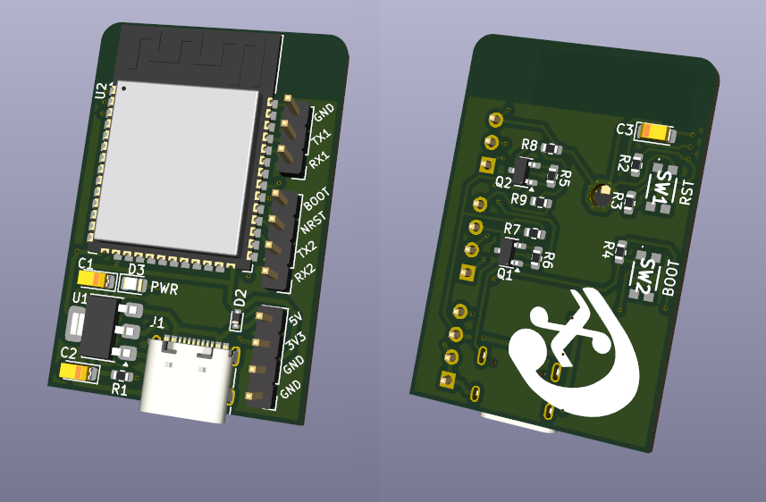
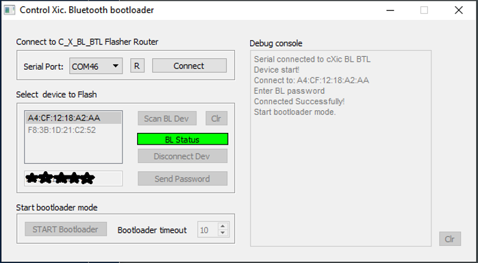

# Control Xic Bluetooth Bootloader  

# Wireless STM32 Programming via Bluetooth

## Project Overview

Program an STM32 microcontroller over Bluetooth using two ESP32s in a master-slave configuration.

The project includes a Windows desktop application built with Qt, which allows users to securely select the target device to be flashed. The remote device can even be password-protected.

One ESP32 is connected to the PC, while the other is embedded in the target PCB alongside the STM32 microcontroller.

The main goal is to flash STM32 MCUs wirelessly.

I am fully aware that this approach is somewhat redundant — a bit like using a cannon to kill a fly — especially considering that an ESP32 could simply handle firmware updates via OTA or other methods. Nevertheless, this is the specific research project I have chosen to pursue.

Needless to say, the STM32 is the king of peripherals and the gold standard among microcontrollers.

## System Architecture

- **PC:** Windows desktop application developed with Qt.
- **Master ESP32:** Connected to the PC and responsible for wireless communication.
- **Slave ESP32:** Embedded in the target PCB alongside the STM32.
- **Target MCU:** STM32 microcontroller to be programmed.

## Main Features

- Wireless communication between two ESP32 modules.
- Remote STM32 firmware programming.
- Windows desktop interface built with Qt.
- Secure target device selection.
- Optional password protection for remote devices.
- Connect STM32CubeProgrammer and configure UART 115200 E81

